# 🤖 Robot móvil autónomo para desinfección de pisos con luz UV-C

**Robot omnidireccional que mapea un cuarto con visión RGB-D, planifica una ruta que cubre todo el piso y la recorre de forma autónoma con lámparas UV-C encendidas.**


<p align="center">
  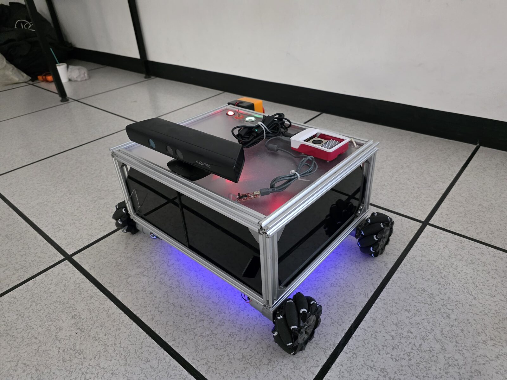
</p>

> Proyecto de titulación (Trabajo Terminal II) · Ingeniería en Mecatrónica · **UPIITA – Instituto Politécnico Nacional** · Junio 2025

**English summary:** Autonomous mecanum-wheeled robot for UV-C floor disinfection. It builds a map with a Kinect + RTAB-Map (visual SLAM), computes a full-coverage path with a custom planner (greedy coverage search + A* to the nearest unvisited cell), and executes it through Nav2 while switching the UV-C lamps on. Raspberry Pi 5 runs ROS 2 Jazzy; two ESP32 boards handle motor control/odometry (UART) and lamps/battery monitoring (Wi-Fi). Includes a web dashboard for monitoring and teleoperation.

---

## 🎥 Demo

▶️ **[Videos de las pruebas de funcionamiento](https://drive.google.com/drive/folders/1-q5oA7UUAarm35ZeRpTiOywxEPPgnvUW)**

<!-- TODO: cuando subas el video a YouTube, reemplaza el enlace de arriba por una miniatura clicable:
[](https://youtu.be/TU_VIDEO)
-->

| Ruta de cobertura generada sobre el mapa real | Robot en prueba (Laboratorio de Metrología, UPIITA) |
|---|---|
| 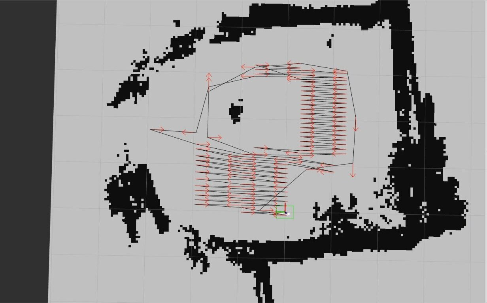 | 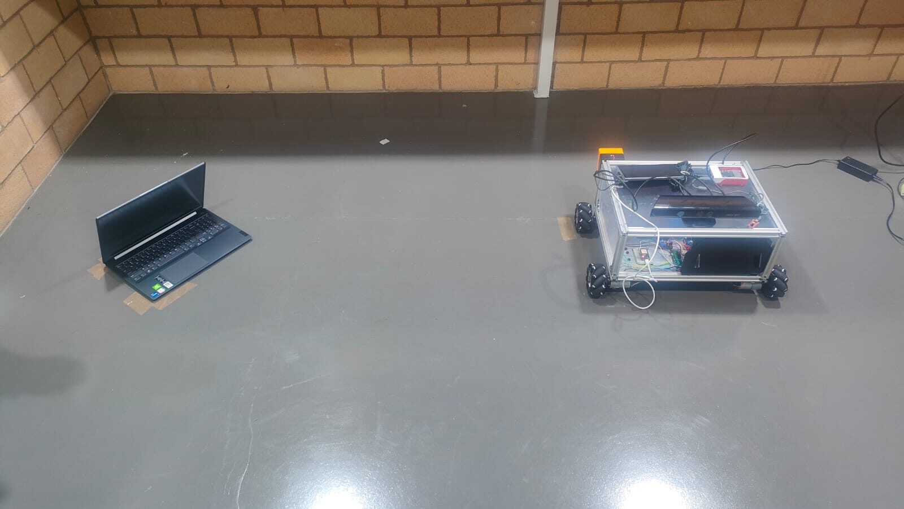 |

---

## 👤 Mi rol en el proyecto

<!-- TODO: completa esta sección. Es lo primero que lee un reclutador. Ejemplo:
- Diseñé e implementé el planificador de cobertura (CPP + A*) y su integración con Nav2.
- Desarrollé los nodos de ROS 2 que comunican la Raspberry Pi 5 con las ESP32 (UART y Wi-Fi).
- Realicé las pruebas de detección de obstáculos con YOLOv8.
-->

_Proyecto de titulación desarrollado en equipo de 3 integrantes. Asesores: M. en E. Elizabeth Rivas Bonilla y Dr. Rodrigo Eduardo Arévalo Ancona._

---

## 🧩 El problema

La desinfección manual de pisos en hospitales, escuelas y gimnasios expone al personal a patógenos, consume químicos y depende de que alguien recorra **todo** el área. La luz UV-C (100–280 nm) inactiva virus y bacterias sin químicos, pero es peligrosa para las personas. Por eso conviene que la aplique un robot.

**Objetivo:** que un robot recorra de forma autónoma el 100 % del piso libre de un cuarto de hasta 5 × 5 m, evite los obstáculos fijos y mantenga las lámparas UV-C a ras de piso.

## ⚙️ Cómo funciona

1. **Mapeo:** el robot se teleopera desde la interfaz web mientras un Kinect captura RGB-D; RTAB-Map construye la nube de puntos 3D y el mapa de ocupación 2D.
2. **Planificación de cobertura:** `coverage_node` infla los obstáculos, reduce la resolución del mapa y calcula una ruta que pasa por todas las celdas libres.
3. **Ejecución:** `goal_pose_sequencer` envía la ruta como una secuencia de metas a Nav2 y publica el progreso de la desinfección.
4. **Desinfección segura:** las lámparas solo se encienden si el mapa está guardado, la batería tiene carga suficiente y la comunicación es estable.

| Mapeo 3D (RTAB-Map) | Mapa 2D en RViz |
|---|---|
| 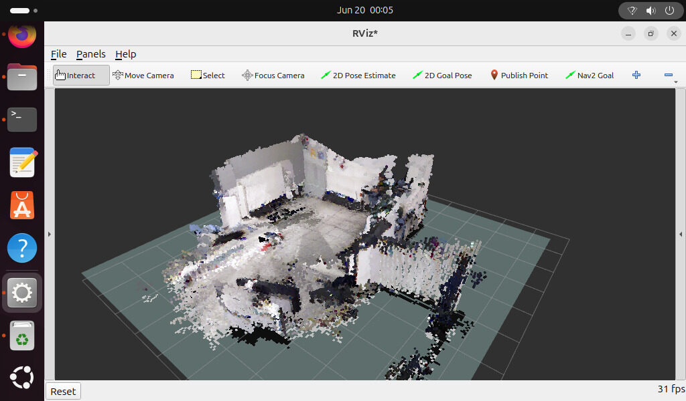 | 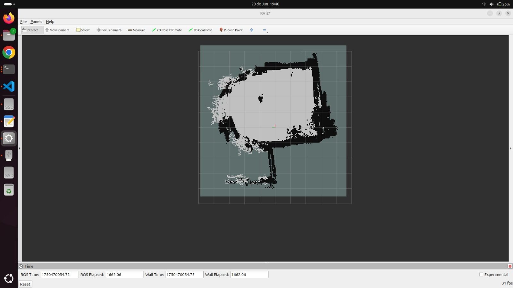 |

---

## 🧠 Planificador de cobertura (CPP + A\*)

Implementado desde cero en [`coverage_planner.py`](ros2_ws/src/uvc_robot/uvc_robot/coverage_planner.py) como una **máquina de estados**:

```
COVERAGE_SEARCH ──(se queda sin vecinos libres)──► NEAREST_UNVISITED_SEARCH (A*)
       ▲                                                   │
       └────────────(llega a una celda no visitada)────────┘
                    ...hasta FOUND (cobertura total) o NOT_FOUND
```

- **Búsqueda de cobertura (greedy):** en cada paso elige la celda vecina libre con menor costo = costo acumulado + **costo de la acción** + heurística. Las acciones penalizan las maniobras: avanzar `0.1`, girar `0.2`, retroceder `0.4`. Esto favorece trayectos rectos.
- **Heurística vertical** para la cobertura, que produce el patrón de "barrido" (tipo *boustrophedon*). También están disponibles Manhattan, Chebyshev y horizontal.
- **A\* hacia la celda no visitada más cercana** cuando el barrido queda encerrado, para reconectar con la siguiente zona libre.

En [`coverage_node.py`](ros2_ws/src/uvc_robot/uvc_robot/coverage_node.py) el mapa real se prepara antes de planificar:

- Inflado de obstáculos con un **margen de seguridad de 0.25 m**.
- Remuestreo a **celdas de 0.05 m**.
- Conversión de la ruta a metas espaciadas **cada 0.5 m**, con orientación (*yaw*) hacia el siguiente punto.

**Pruébalo sin ROS:**

```bash
pip install numpy matplotlib
python demo/demo_cobertura.py
```

<p align="center">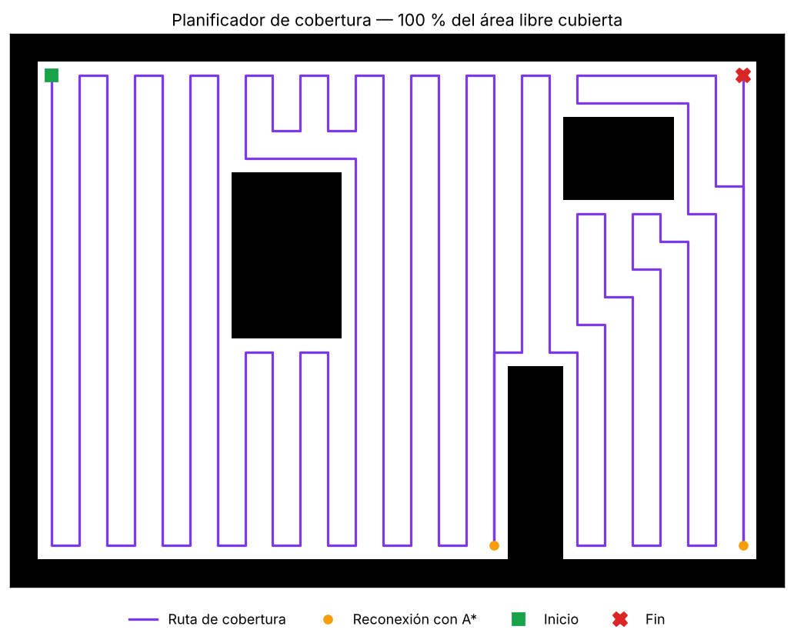</p>

---

## 🏗️ Arquitectura

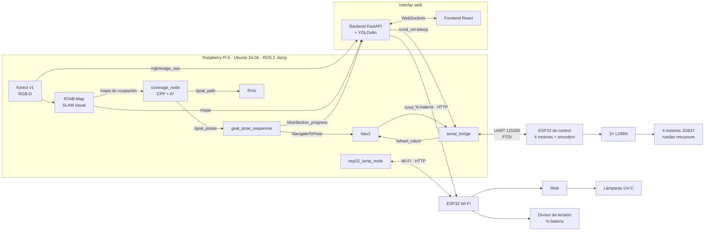

| Nodo | Entrada | Salida | Función |
|---|---|---|---|
| `coverage_node` | mapa de ocupación (`/map2`) | `/goal_poses`, `/goal_path`, `/start_marker` | Prepara el mapa y genera la ruta de cobertura |
| `goal_pose_sequencer` | `/goal_poses` | acción `NavigateToPose`, `/disinfection_progress` | Ejecuta la ruta meta por meta con Nav2 |
| `serial_bridge` | `/cmd_vel` | `/wheel_odom` | Envía `[vx, vy, ωz]` por UART y publica la odometría de las ruedas |
| `esp32_lamp_node` | `/encender_lampara` | `/bateria_percent` | Controla las lámparas y lee la batería por HTTP |

---

## 🔩 Hardware

| Subsistema | Componentes |
|---|---|
| Estructura | Chasis de perfil de aluminio 20×20 mm, placa de aluminio y acrílico · < 15 kg |
| Locomoción | 4 ruedas **mecanum** (movimiento omnidireccional) · 4 motores JGB37-3530B con encoder · 2 puentes H L298N |
| Percepción | Kinect v1 (RGB-D) |
| Procesamiento | Raspberry Pi 5 (nodos ROS 2, mapeo, planificación, interfaz) |
| Control y comunicación | ESP32 de control (motores + odometría, UART) · ESP32 Wi-Fi (lámparas + batería) · FTDI FT232RL |
| Desinfección | Lámparas UV-C a ras de piso, separadas 42.85 mm, activadas por relé |
| Energía | Batería de 24 V · reguladores XL4016 para 5 V / 12 V / 23 V · cargador · botones de encendido |
| Interfaz | Pantalla de 7" · dashboard web con WebSockets |

<table>
  <tr>
    <td>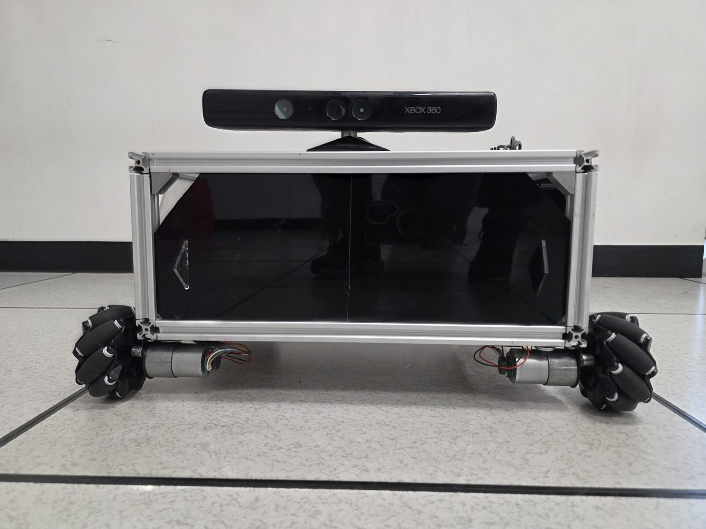</td>
    <td>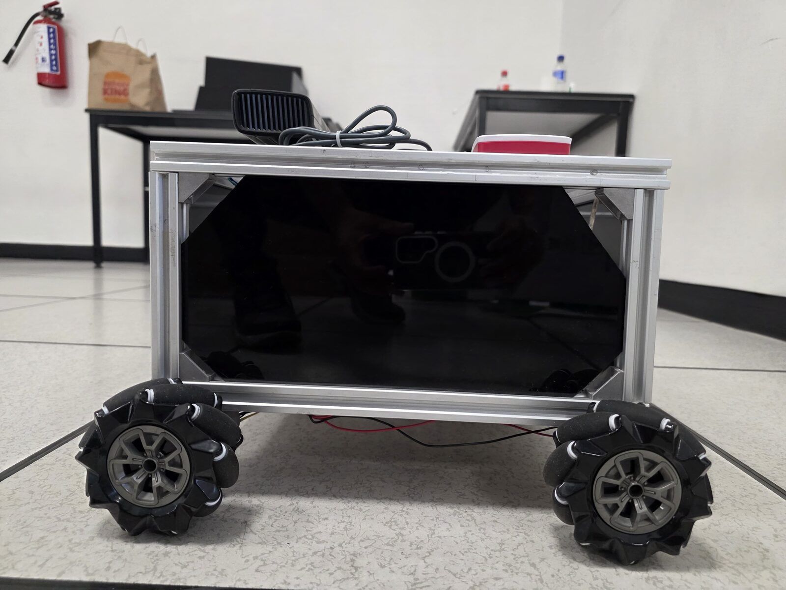</td>
    <td>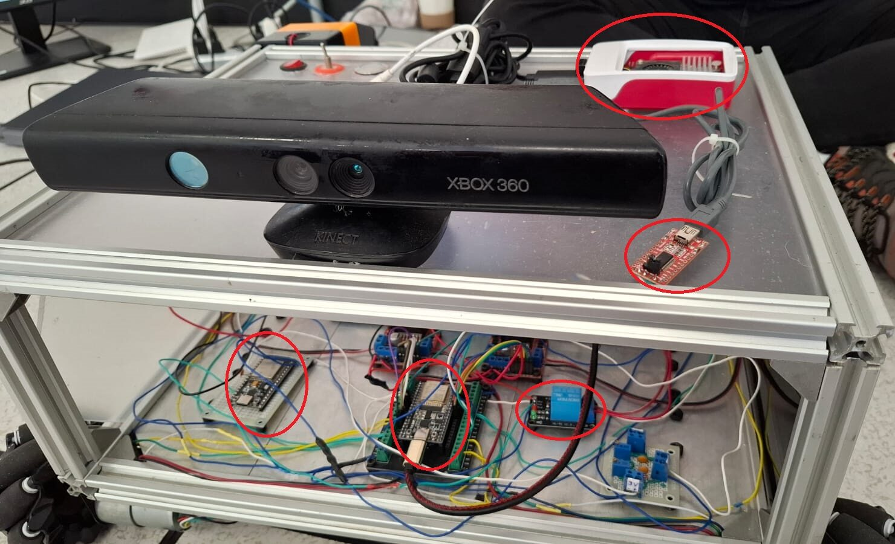</td>
  </tr>
  <tr>
    <td>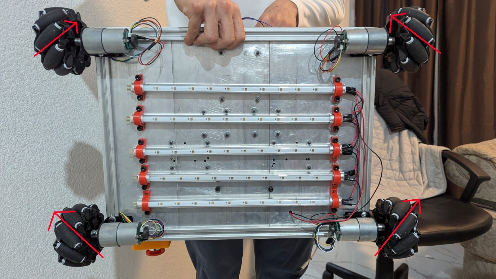</td>
    <td>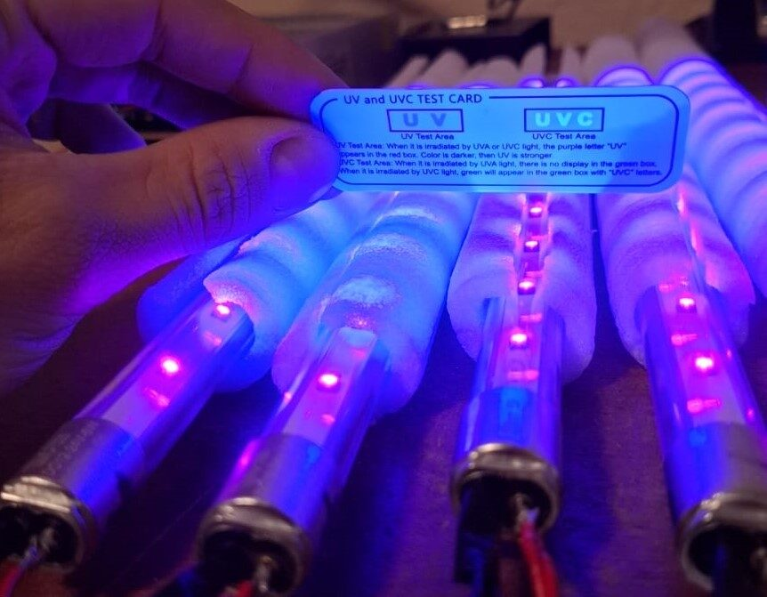</td>
    <td>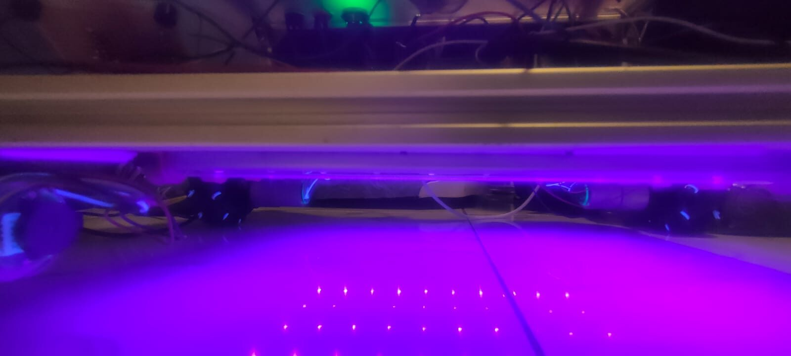</td>
  </tr>
</table>

---

## 🖥️ Interfaz web

Aplicación de una sola página (SPA) en **React + Tailwind CSS** con un backend en **FastAPI** que funciona como puente con ROS 2 mediante WebSockets ([`web/`](web/)). Muestra en tiempo real la cámara con las detecciones de **YOLOv8n**, el mapa, el nivel de batería con alertas sonoras y el progreso de la desinfección. Desde el panel se puede iniciar la desinfección o hacer un paro de emergencia, y la página de control remoto permite teleoperar el robot con un D-pad o con las teclas WASD/flechas.

| Panel principal | Teleoperación |
|---|---|
| 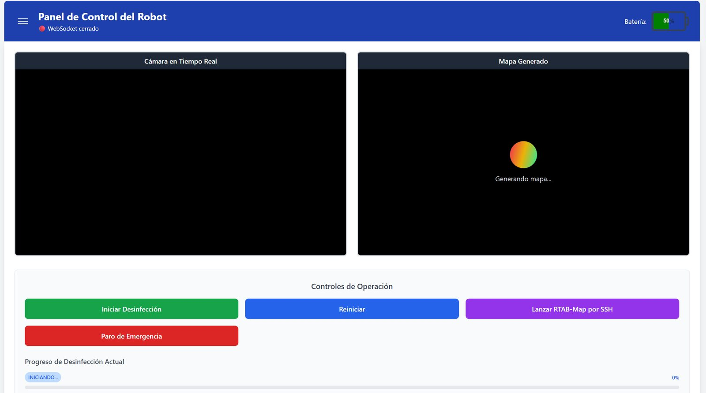 | 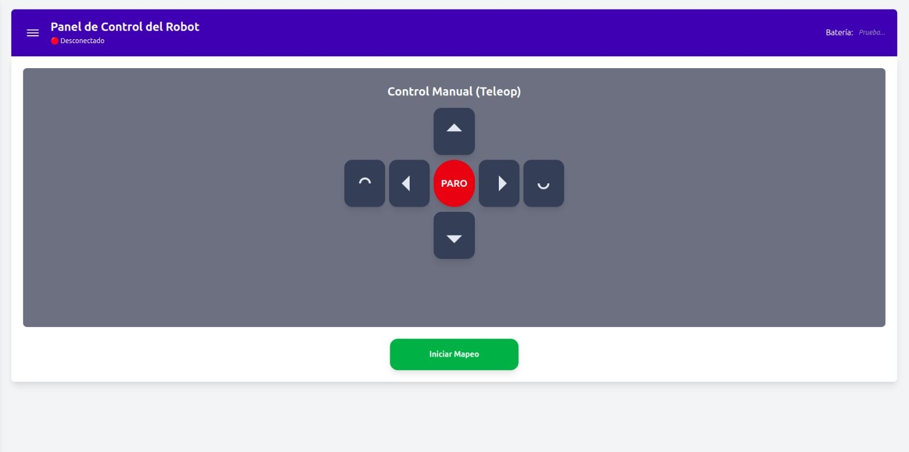 |

---

## ✅ Resultados

- **11 requerimientos de diseño cumplidos:** dimensiones del entorno, detección de obstáculos de ≥ 9 × 9 × 12 cm, tipo de superficie y emisión en el rango UV-C. La altura del entorno solo se validó en parte, por el campo de visión vertical del Kinect.
- **Navegación autónoma completa** en el Laboratorio de Metrología de UPIITA: mapeo teleoperado → ruta de cobertura → recorrido autónomo sin colisiones con obstáculos fijos.
- **Comunicación UART y Wi-Fi simultánea** sin pérdida de datos durante la navegación.
- **Activación segura de las lámparas**: solo encienden con el mapa guardado, batería suficiente y comunicación estable.
- **Costo de materiales: $15,721 MXN.**

**Limitaciones y trabajo futuro:**

- Validación germicida: se verificó la emisión UV-C, pero no se hizo un ensayo biológico.
- Percepción: cambiar el Kinect por un **LiDAR** daría mapas más precisos e independientes de la iluminación.
- Cómputo: migrar a una **Jetson Orin Nano** permitiría fusión de sensores y detección en tiempo real.
- Comportamiento: agregar **árboles de comportamiento** y replanificación para entornos dinámicos con personas.

---

## 📁 Estructura del repositorio

```
.
├── ros2_ws/src/uvc_robot/        # Paquete ROS 2 (ament_python)
│   ├── uvc_robot/
│   │   ├── coverage_planner.py   # Planificador CPP + A* (sin dependencias de ROS)
│   │   ├── coverage_node.py      # Mapa → ruta de cobertura → PoseArray
│   │   ├── goal_pose_sequencer.py# Ejecuta la ruta con Nav2 y publica el progreso
│   │   ├── serial_node.py        # Puente UART ↔ ESP32 (cmd_vel / odometría)
│   │   └── esp32_lamp_node.py    # Puente Wi-Fi ↔ ESP32 (lámparas / batería)
│   └── launch/
│       └── mapeo_rtabmap.launch.py # Kinect + odometría visual + RTAB-Map
├── web/
│   ├── backend/main.py           # FastAPI: puente ROS 2 ↔ WebSockets + YOLOv8
│   └── frontend/                 # React + Tailwind
├── demo/demo_cobertura.py        # Demo del planificador sin ROS
└── docs/img/                     # Fotos y capturas
```

<!-- TODO (pendiente de agregar):
- firmware/   → código de las ESP32 (control mecanum + odometría, lámparas + batería)
- web/frontend/src/pages/ → páginas de la interfaz (HomePage, DashboardPage, RemoteControlPage, SettingsPage, MainLayout)
- auto_map_saver_pkg → nodo que guarda el mapa (lo usa mapeo_rtabmap.launch.py)
- launch y parámetros de Nav2
-->

## 🚀 Ejecución (ROS 2 Jazzy)

```bash
cd ros2_ws
colcon build --packages-select uvc_robot
source install/setup.bash

# 1) Mapeo (teleoperando el robot)
ros2 launch uvc_robot mapeo_rtabmap.launch.py

# 2) Cobertura y desinfección
ros2 run uvc_robot serial_bridge --ros-args -p serial_port:=/dev/ttyUSB0
ros2 run uvc_robot esp32_lamp_node
ros2 run uvc_robot goal_pose_sequencer
ros2 run uvc_robot coverage_node      # requiere el mapa publicado y Nav2 activo
```

Para la interfaz web, consulta [`web/README.md`](web/README.md).

---

## 📄 Documentación

Tesis completa: *"Robot móvil autónomo con navegación mediante visión artificial para la desinfección de pisos con luz ultravioleta"*. Incluye la metodología de diseño mecatrónico (modelo V, IDEF0, matriz morfológica, AHP), el diseño detallado de 13 módulos, la integración, las pruebas y el análisis de costos.

<!-- TODO: agrega el enlace al PDF (repositorio institucional del IPN o Drive). No lo subas a GitHub: pesa ~70 MB. -->

## 📬 Contacto

**Jesus Eduardo Agua Cervantes** · Ingeniero en Mecatrónica
<!-- TODO: LinkedIn · correo -->
